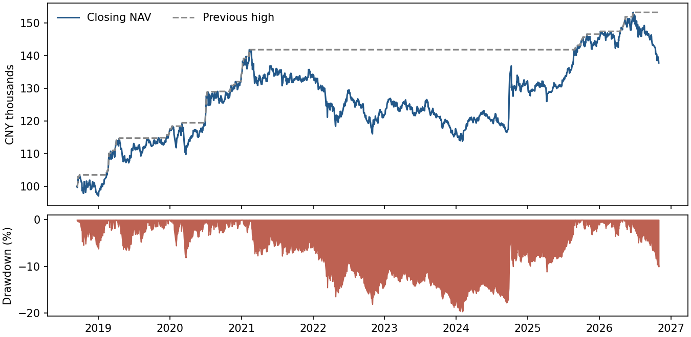

# 历史回撤恢复与两期持仓披露

10万元月度50/50、基准费用历史账户共47段收盘回撤，46段在样本内恢复。最大一段下跌19.73%，从高点到恢复经历1,102个交易日间隔。研究区间为2018-09-14至2026-10-30，共1,967个已准入交易日。

| 主组合区间 | 前高 | 谷值 | 首次恢复 | 峰至谷 | 谷至恢复 | 峰至观察终点 |
|---|---|---|---|---:|---:|---:|
| 最大回撤 19.73% | 2021-02-10 | 2024-02-02 | 2025-08-29 | 723日 | 379日 | 1,102日 |
| 期末仍在回撤 10.09% | 2026-06-22 | 2026-10-30 | 未观察到 | 88日 | 未知 | 88日 |

上图纵轴分别为千元和百分比。交易日间隔以峰值日为第0日，首次收盘净值达到或超过前高即算恢复。高点持平时取下跌前最后一个同高收盘，谷值并列时取第一次。明细还给出实际低于前高的收盘数和自然日跨度。对于期末尚未恢复的区间，“峰至观察终点”是已观察时长的下限，恢复日期和谷至恢复时长留空。

| 策略（基准费用） | 回撤段数 | 已恢复 | 最长已恢复区间（交易日） | 期末未恢复已历交易日 |
|---|---:|---:|---:|---:|
| 现金 | 0 | 0 | — | — |
| 股票ETF持有 | 28 | 27 | 171 | 1,382 |
| 债券ETF持有 | 117 | 116 | 407 | 1 |
| 月度20/80 | 80 | 79 | 370 | 88 |
| 月度50/50 | 47 | 46 | 1,102 | 88 |
| 120日趋势 | 24 | 23 | 113 | 1,382 |

18个历史账户的35,406条日净值产生884段回撤，其中869段已恢复，15段截至期末仍在观察。同一市场行情会在多个组合和费用档中重复出现，这些段数按账户计算。全部区间、金额和持续时间可逐行查看。[逐段明细](episodes.csv) · [逐账户统计及净值来源](summary.json)

## 6月底与9月底的持仓变化

510300比较两次披露的**指数投资部分**，权重分母取各自报告期末的基金净资产。6月底取中报完整指数持仓的前十，9月底取三季报公布的指数前十。两期重合8只，合计权重由23.24%降到22.52%。长江电力从第17升到第10，药明康德从第20升到第8。兆易创新、寒武纪在6月底分别排第5、第6，9月底榜外，9月的精确权重留空。上述变化为两个报告时点的排名及权重，实际区间交易流水未知。

511010按官方交易所及银行间代码归并同一期国债，使用各报告期末净资产作分母。每期只披露前五个代码，某一期国债的实际占比至少等于它已披露的合计权重，至多再加当期全部未逐项披露的债券权重。分别组合两个时点的上下界，可判断以下方向。表内界值是近似数，逐项精度见明细。

| 国债期次 | 9月底相对6月底的净资产权重变化范围（百分点） | 可确认方向 |
|---|---:|---|
| 2025年二十期 | −53.01 至 −30.41 | 下降 |
| 2026年三期 | −12.69 至 +9.92 | 未定 |
| 2026年八期 | −7.47 至 +15.13 | 未定 |
| 2026年十五期 | +26.63 至 +49.23 | 上升 |

两期比较的资料截止日为2026-06-30和2026-09-30，中报分别于8月29日、31日公告，两份三季报均于10月27日公告。各期次的范围单独计算，不可把全部上限同时相加。研究未把披露权重写入历史收益路径。[逐项持仓、日期和来源摘要](disclosures.json) · [中报取证](../2026-11-06-research-audit/holdings.json) · [三季报取证](../../data/reference/holdings_2026q3.json)

## 离线验证

在项目根目录用 `python scripts/review_recovery.py --output 新目录` 生成区间，再用 `python scripts/compare_disclosures.py --output 新目录/disclosures.json` 和 `python scripts/check_recovery_review.py --folder 新目录` 生成并验证披露比较。检查器以累计最高净值标记水下收盘，独立找出连续区间，逐段核对峰谷、恢复日期、金额、跌幅及日数，并重做两期披露提取，核对各债券期次的边界组合。225项回归测试通过，含重复峰谷、回到同高、期末未恢复及现金账户。项目最新前瞻核验日仍为11月6日，已有2个前瞻观察日。
