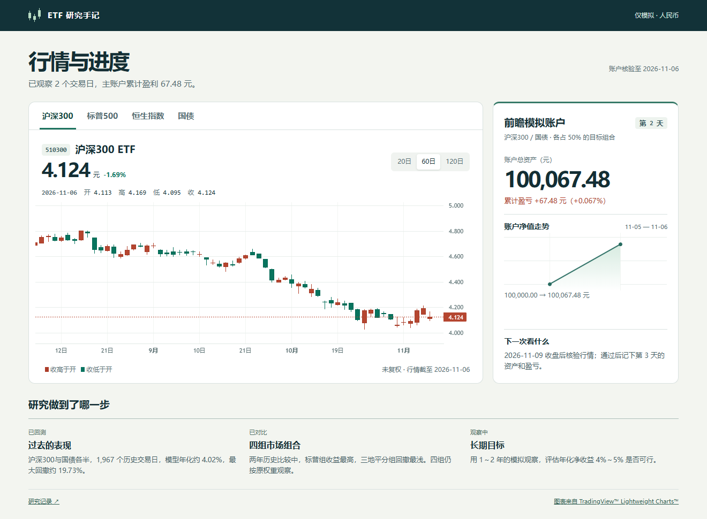

# 行情与进度看板

电脑和手机连接部署主机所在局域网，用浏览器访问该主机的 18766 端口。服务默认绑定本机；局域网部署通过本机 systemd 覆盖项设置 `ETF_DASHBOARD_BIND` 为该网卡的 IPv4 地址。

点击基金名称切换沪深300（510300）、标普500（513500）、恒生指数（159920）或国债（511010），选择最近 20、60 或 120 个交易日。鼠标悬停或在图表上按左右方向键查看日期、开高低收。报价旁的百分比为最新收盘相对前收的变化；红绿蜡烛比较当天开盘与收盘。价格为境内 ETF 人民币未复权成交行情。

主账户取冻结的月度 50/50、基准费用组合，仅绘制真实前瞻观测日。未调整交易协议。局域网服务每次读取活动指针，指针变化后重新验证已封存报告、账户摘要和同期行情前缀。保持页面开启时每分钟读取一次；新日通过原有准入流程后才会显示。跨境 ETF 使用已核验的四组历史比较输入，行情截止日单独标在图下。GitHub 上的图片和静态数据是本次提交的快照。

本机查看可在已安装研究依赖和 `requirements-evidence.txt` 的项目目录运行 `python scripts/serve_market.py`，然后打开 `http://127.0.0.1:18766/`。静态站点可在新目录用 `--export` 写出 `market-data.json`，与 `site/market.html`、`market.css`、`market.js`、`vendor-charts/` 一起通过 HTTP 提供。随仓库分发的 Lightweight Charts 为 5.0.9，浏览器无需连接外部图表服务。[图表库与许可](../../site/vendor-charts/LICENSE.txt)
