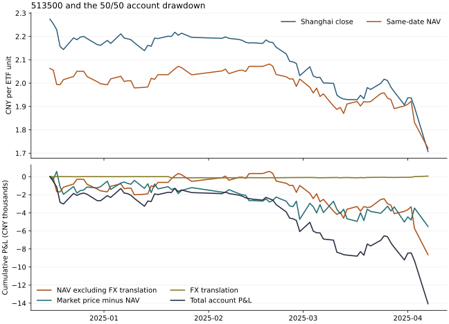

# 跨境 ETF 的人民币净值、场内折溢价与标普账户回撤

两年期标普股债账户从 2024-12-16 的 107,263.64 元跌至 2025-04-07 的 93,197.64 元，72 个收盘间隔合计亏损 **14,066.00 元，回撤 13.1135%**。其中，持有的标普 ETF 人民币单位净值变动贡献 **−8,581.00 元**，场内每份价格相对净值的差额收窄贡献 **−5,514.40 元**。后一项约占账户净损失的 **39.20%**。人民币对美元的估值折算项在这次回撤中略有抵消作用。[原四组账户、权重与峰谷](../2026-11-08-three-markets/PROGRESS.md)

## 同一估值日期的对照

收盘价与单位净值均为人民币元/份，汇率为人民币元/1 外币。折溢价率按场内收盘价除以同日人民币单位净值再减一。基金使用各自披露的估值日期。美股收盘晚于同日境内收盘，港股与境内市场收盘时刻和假期也有差异。该差额包含时差和后续海外价格信息，适用于事后解释；盘中可知的 IOPV、真实申赎套利价差和可成交收益均未知。

| ETF | 日期 | 场内收盘价 | 人民币单位净值 | 每份价差 | 折溢价率 | 中间价 |
|---|---|---:|---:|---:|---:|---:|
| 博时标普500 513500 | 2024-12-16 | 2.2740 | 2.0631 | +0.2109 | +10.22% | USD 7.1882 |
| 博时标普500 513500 | 2025-04-07 | 1.7070 | 1.7208 | −0.0138 | −0.80% | USD 7.1980 |
| 华夏恒生 159920 | 2024-12-16 | 1.2230 | 1.2142 | +0.0088 | +0.72% | HKD 0.92444 |
| 华夏恒生 159920 | 2025-04-07 | 1.2750 | 1.2224 | +0.0526 | +4.30% | HKD 0.92612 |

标普 ETF 在上述两日之间场内价跌 24.93%，人民币单位净值跌 16.59%。恒生 ETF 同期场内价涨 4.25%，净值涨 0.68%。整个 2023-10-30 至 2026-10-30 样本中，标普同日折溢价率的最低、中位和最高分别为 −7.25%、+3.73%、+11.77%，728 日中有 257 日高于 5%。恒生三项分别为 −3.00%、+0.10%、+4.30%，没有一日高于 5%。5% 仅是描述统计。[两只 ETF 各 728 日的价格、三方净值、双源汇率与核验状态](market.csv)

## 账户回撤的人民币贡献

逐日采用上个收盘的实际持仓量，所有百分点均以峰值权益 107,263.64 元为分母。标普 ETF 在峰值日持有 23,900 份，谷底日持有 25,700 份；债券 ETF 两端均为 300 份。

| 组成 | 人民币损益 | 对峰值权益的贡献 |
|---|---:|---:|
| 将基金净值按美元中间价还原后的变化 | −8,640.35 | −8.0552 个百分点 |
| 美元中间价变化的折算贡献 | +59.35 | +0.0553 个百分点 |
| 场内价与人民币净值的每份差额变化 | −5,514.40 | −5.1410 个百分点 |
| 511010 国债 ETF 价格变化 | +16.20 | +0.0151 个百分点 |
| 新增分红应收 | 0.00 | 0.0000 个百分点 |
| 调仓当天实际增减份额从开盘至收盘的变化 | +36.30 | +0.0338 个百分点 |
| 模型滑点 / 佣金 | −3.10 / −20.00 | −0.0029 / −0.0186 个百分点 |
| **账户总变化** | **−14,066.00** | **−13.1135 个百分点** |

还原后的净值变动含底层证券表现、股票股息、基金费用、资金持有和跟踪差异。+59.35 元来自将整份基金净值按同日美元中间价进行数学折算。基金真实逐日美元资产负债、外汇对冲头寸和证券级别损益没有取得；基金会计中的实际汇兑损益、纯标普指数贡献均保留未知。[逐日现金单位损益和对账残差](drawdown.csv) · [精确金额、占比与两种分法](attribution.json)



| 月份（首尾为部分月份） | 账户变化 | 还原美元口径的净值变化 | 汇率折算 | 场内每份价差变化 |
|---|---:|---:|---:|---:|
| 2024-12，峰值收盘后 | −2,660.90 | −1,569.31 | +1.47 | −1,108.96 |
| 2025-01 | +897.80 | +1,048.94 | −127.38 | −106.36 |
| 2025-02 | −4,314.30 | −459.78 | +27.05 | −3,503.67 |
| 2025-03 | −3,142.70 | −2,856.74 | +28.26 | −301.92 |
| 2025-04，至 04-07 收盘 | −4,845.90 | −4,803.46 | +129.95 | −493.49 |

2 月的主要损失来自场内每份价差收窄。3 月和 4 月初的主要损失来自美元口径基金净值走低。表中三列股票因素与账户变化的差额为债券、调仓和费用。若从峰值一路保留当日的股债份额与现金，这段路径的损益为 −13,535.10 元；按既定规则实际模拟的四次调仓及其后持仓变化使期末再少 530.90 元。这是另一种持仓路径比较，另外加进上表会重复计数。

## 如何对账

1. 设人民币收盘价为 P、单位净值为 N。上日收盘的股票份额乘上净值变化与每份价差 (P−N) 的变化，两项相加即该持仓的人民币市价损益。使用每份价差，是为了直接对到账户金额。如果改用折溢价率，并将净值和折溢价率的乘积交互项各分一半，价差贡献为 **−5,164.08 元**，两种分法的账户总损益相同。
2. 对人民币净值 N，令 X 为每美元人民币中间价，U=N/X。每日按两端 U 的平均值乘 X 的变化得到汇率项，按两端 X 的平均值乘 U 的变化得到其余净值项。两项再乘昨日份额，恰好得到人民币净值损益。日内真实交易与资产估值汇率例外若无证据，保留未知。
3. 对每日新增或卖出的份额，以有符号成交数量分别乘「收盘−开盘」与「开盘−模型成交价」，再扣佣金。上日债券持仓按价格变化计价，分红按登记份额在除息日确认；到账只是应收转现金。按此口径可还原原账户每个收盘间隔的损益。
4. 仅从原报告读入四组中两年期标普账户的持仓、成交与权益；三年期标普账户即使峰谷同日，持仓数量也可能不同。比较程序从原始证据重建市场数据，复核程序用期末持仓市值减期初持仓市值再扣除份额变化，单独验证了股票净值、价差、汇率和完整账户回撤。任一日期净值缺少有效交叉来源或相互冲突时，该日折溢价为空；区间缺可用汇率时保留人民币净值总变化，不能分解的部分单列。

## 证据与复现

- 场内未复权收盘价复用冻结比较中的交易所与新浪双源数据。单位净值来自博时官网“单位净值”年度曲线及华夏官网历史净值 37 页，再与天天基金、同花顺逐日核对，两个基金全部 1,456 个「基金×日期」三方一致。使用单位净值，避免把累计净值或场内价格当成基金资产净值。[博时基金](https://www.bosera.com/fund/513500.html) · [华夏基金](https://www.chinaamc.com.cn/fund/159920/lishijingzhi.shtml)
- 人民银行门户的美元、港元历史序列与国家外汇管理局转发的中国外汇交易中心中间价逐日对齐。外汇局报价按每 100 外币，转换后 1,456 项完全相符。两处是同一官方基准的发布渠道。博时 2024-09-30、2025-01-27、2025-03-21 三版招募说明书 PDF 第 74 页均列有主要外币估值中间价和取价例外；华夏 2024-05-31、2025-03-21 两版分别见 PDF 第 55、53 页。基金每日实际使用的例外汇率未知。[官方中间价与单位](https://www.safe.gov.cn/safe/rmbhlzjj/) · [人民银行美元序列](https://wzdt.pbc.gov.cn/huilv/flex-xml/flex_xml_1.xml) · [人民银行港元序列](https://wzdt.pbc.gov.cn/huilv/flex-xml/flex_xml_4.xml)
- 原始请求按顺序封存，包括无可用数据的响应、博时明细接口的 403、ECB 下载超时和替代成功来源。所有请求含 URL、时间、响应状态和 SHA256。[首批来源](../../data/snapshots/2026-11-08-nav-fx-0536a/requests.json) · [外汇局与同花顺](../../data/snapshots/2026-11-08-nav-fx-0536b/requests.json) · [外汇局全期表](../../data/snapshots/2026-11-08-nav-fx-0536c/requests.json) · [华夏前两页](../../data/snapshots/2026-11-08-nav-fx-0536d/requests.json) · [华夏其余页](../../data/snapshots/2026-11-08-nav-fx-0536e/requests.json) · [博时年度净值](../../data/snapshots/2026-11-08-nav-fx-0536f/requests.json) · [说明书与汇率入口](../../data/snapshots/2026-11-08-nav-fx-0536g/requests.json) · [人民银行汇率](../../data/snapshots/2026-11-08-nav-fx-0536h/requests.json) · [期内说明书修订](../../data/snapshots/2026-11-08-nav-fx-0536i/requests.json)

按锁定依赖在项目根目录执行，输出指向新的空闲目录。两次重建 CSV、JSON 和 SVG 字节完全相同。242 项单元测试通过，涵盖来源冲突、净值或汇率缺失及纯汇率变动。

```bash
python scripts/attribute_nav_fx.py --output /tmp/etf-nav-fx-result
python scripts/verify_nav_fx.py /tmp/etf-nav-fx-result
python scripts/plot_nav_fx.py /tmp/etf-nav-fx-result
```

下一项研究宜复核高溢价日境内收盘时可知的最近一期净值、当时可见的美股期货与 IOPV 及其时间戳，再判断上述价差中有多少来自交易时段错位。四组权重继续按既定方案观察。
