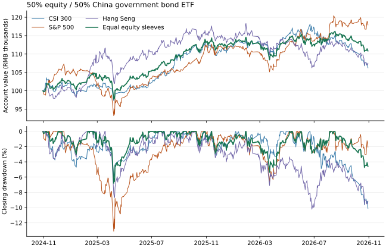

# 沪深300、标普500和恒生指数的人民币股债组合

截至 2026-10-30，按同一模型、同一国债 ETF 和同一境内收盘日比较。相同起止日内，三地平分组合两次都录得最浅的最大回撤；近一年仍亏损 2.71%。标普组合两年累计收益最高，也经历了四组中最深、已修复的两年回撤。

## 同日从现金起步

每个区间独立从 10 万元人民币起步。收益是扣除模型交易费用与滑点后的累计收益。回撤按每日收盘总资产计算。恢复指组合首次回到该次下跌前的收盘峰值，天数按境内交易日计。最大回撤已修复的账户，期末仍可能处在另一次回撤中。

| 区间 | 股票仓位投向 | 累计收益 | 年化收益 | 最大回撤 | 峰值 → 谷底 | 首次恢复日期 | 谷底至恢复 / 峰值至恢复 | 期末回撤 |
|---|---|---:|---:|---:|---|---|---:|---:|
| 1年 | 沪深300 | −5.85% | −5.85% | −10.11% | 2026-06-22 → 10-30 | 截止日仍在谷底 | — | −10.11% |
| 1年 | 标普500 | +4.92% | +4.92% | −6.68% | 2025-11-13 → 2026-03-23 | 2026-05-06 | 28 / 112 | −2.11% |
| 1年 | 恒生指数 | −7.12% | −7.12% | −10.24% | 2026-01-29 → 06-26 | 谷底后已观察84日，尚未恢复 | — | −9.12% |
| 1年 | 三地平分 | −2.71% | −2.71% | −5.41% | 2026-01-29 → 03-23 | 2026-05-07 | 29 / 60 | −4.64% |
| 2年 | 沪深300 | +6.24% | +3.07% | −10.10% | 2026-06-22 → 10-30 | 截止日仍在谷底 | — | −10.10% |
| 2年 | 标普500 | +17.92% | +8.60% | −13.11% | 2024-12-16 → 2025-04-07 | 2025-09-22 | 116 / 188 | −2.07% |
| 2年 | 恒生指数 | +7.50% | +3.68% | −10.22% | 2026-01-29 → 06-26 | 谷底后已观察84日，尚未恢复 | — | −9.15% |
| 2年 | 三地平分 | +10.84% | +5.28% | −6.80% | 2025-02-21 → 04-07 | 2025-06-25 | 53 / 83 | −4.61% |

起始日为 2025-10-30（243 个收盘）或 2024-10-30（486 个收盘）。年化按实际自然日与 365.25 天折算，期末按市值计量。可核对[账户汇总](accounts.csv)、[逐日权益、现金、应收与份额](daily.csv)及[逐笔申请、成交和费用](orders.csv)。



## 滚动起点复核

另从 2023-10-30 建立连续账户，在每个可用收盘截取至一或两个自然年周年日当天或之后首个境内交易日。窗口首日沿用该账户的持仓和现金。每个市场各有 486 个一年窗口、243 个两年窗口。窗口大量重叠，不能按 486 或 243 次独立试验估计成功概率。

| 股票仓位投向 | 滚动1年最低 / 中位 / 最高累计收益 | 亏损窗口 | 滚动2年最低 / 中位 / 最高累计收益 | 两年窗口最深回撤 |
|---|---|---:|---|---:|
| 沪深300 | −5.71% / 10.47% / 22.33% | 19/486 | 4.14% / 22.80% / 28.24% | −10.09% |
| 标普500 | −0.18% / 9.30% / 24.13% | 1/486 | 11.40% / 20.61% / 36.42% | −13.10% |
| 恒生指数 | −7.95% / 14.48% / 27.26% | 76/486 | 6.63% / 25.29% / 38.73% | −10.22% |
| 三地平分 | −2.61% / 11.17% / 19.23% | 8/486 | 10.39% / 22.44% / 31.01% | −6.78% |

[2,916 个窗口的逐项结果](rolling.csv)包括收益、最大回撤、峰值、谷底、恢复日、交易日数及期末回撤。恢复日为空表示截至该窗口末日尚未观察到修复。

## 同期持仓、行业与重复公司

三只股票 ETF 的持仓日均为 2026-09-30，基金于 10-27 披露。表内百分比的分母是各基金资产净值。标普基金对 Alphabet 的 A、C 两类股份列为同一公司第 4 名，按未舍入市值合并得到 5.34%。明细有 11 行证券、10 家公司。[沪深300三季报](https://www.sse.com.cn/disclosure/fund/announcement/c/new/2026-10-27/510300_20261027_82OP.pdf) · [标普500三季报](https://www.sse.com.cn/disclosure/fund/announcement/c/new/2026-10-27/513500_20261027_WI0V.pdf) · [恒生三季报](https://static.cninfo.com.cn/finalpage/2026-10-27/1225624605.PDF)

| 名次 | 沪深300 ETF | 标普500 ETF | 恒生 ETF |
|---:|---|---|---|
| 1 | 中际旭创 3.56% | 英伟达 8.12% | 汇丰控股 7.44% |
| 2 | 贵州茅台 3.09% | 苹果 7.14% | 腾讯控股 7.39% |
| 3 | 宁德时代 3.03% | 微软 5.59% | 阿里巴巴 7.31% |
| 4 | 中国平安 2.23% | Alphabet 5.34% | 建设银行 5.25% |
| 5 | 新易盛 2.13% | 亚马逊 3.59% | 友邦保险 4.24% |
| 6 | 招商银行 2.01% | 博通 2.45% | 工商银行 3.54% |
| 7 | 紫金矿业 1.93% | Meta 2.35% | 中国移动 2.76% |
| 8 | 药明康德 1.63% | 美光 1.77% | 香港交易所 2.60% |
| 9 | 美的集团 1.53% | 特斯拉 1.47% | 小米集团 2.53% |
| 10 | 长江电力 1.37% | AMD 1.47% | 中国银行 2.41% |
| **合计** | **22.52%** | **39.28%** | **45.46%** |

- 沪深300基金制造业 55.59%、金融业 20.57%、采矿业 5.46%。对应三地平分组合总资产的目标敞口分别约为 9.27%、3.43%、0.91%，仅计这一只 ETF 的贡献。
- 标普基金信息技术 38.45%、金融 11.04%、电信业务 9.63%。信息技术单项为平分组合贡献约 6.41%。恒生基金金融 30.80%、非必需消费品 16.60%、通信服务 13.94%，金融单项贡献约 5.13%。
- 各基金持有股票占净值 97.20%、96.19%、91.94%。报告保留原行业分类及币种折算后的人民币公允价值。境内制造业包含部分科技企业，直接与 GICS 信息技术相加会改变分类含义。全行业公允价值及权重、证券代码、同公司不同股类见[穿透明细](holdings.json)。
- 三份季度前十大公司名单两两交集为零。为检验名单之外的重复，另查 **2026-06-30** 同期中报，按发行人核对沪深300与恒生基金的 A/H 股，确认至少 **20 家**，按当时基金净值权重折算，合计约占平分组合总资产 **7.53%**。其中建设银行为 (0.28% + 4.83%) / 6 ≈ 0.85%，宁德时代为 (3.55% + 0.91%) / 6 ≈ 0.74%。这是半年末已证实的下限。三季度全持仓交集、全市场三方共持及 9 月底该下限的数值均未知。[沪深300半年报逐股明细](../2026-11-06-research-audit/stocks_2026h1.csv) · [恒生半年报](https://static.cninfo.com.cn/finalpage/2026-08-31/1225528031.PDF)
- 四组共用 511010。按三季报已披露证券合并同一期国债，26 国债 08 和 26 国债 15 分别约占债券基金净值 38.32% 和 38.22%，若恰达 50% 债券目标，分别约占组合总资产 19.16% 和 19.11%。[国债代码与同券合并核对](../2026-11-07-daily-evidence/PROGRESS.md)

## 模拟和证据口径

- 使用境内人民币上市的 510300、513500、159920 和 511010。前三组分别给一只股票 ETF 50%，第四组各给三只股票 ETF 精确的 1/6，均给 511010 目标 50%。每次建组首个收盘持现金，次日及以后每月首个境内交易日按上个交易日收盘的权益和价格生成整手目标。在当日模型开盘价先卖后买，买入按沪深、标普、恒生、国债的固定顺序，现金不足缩量，无借款。100份一手，0.001元一档，双边佣金万三且单笔最低5元，单边滑点5基点并按不利方向取整，无卖出税。实际比例受整手、价格与现金约束。
- 国内基础数据从原有经交易日历、未复权行情与官方分红核验的 1,967 日数据中截取。收盘资产包括现金、份额市值和除息应收。登记日收盘确定份额，除息日确认应收，派发日入现金，下一交易日才可用于下单。
- 两只跨境 ETF 的境内未复权开高低收在 728 个共同交易日逐字段对齐交易所行情服务与新浪，参照覆盖日期内的搜狐记录。另核验 513500 的上交所公告目录 685 条、159920 的巨潮基金公告目录 116 条，并与分红拆分表交叉检查。样本内未检出这两只基金向份额持有人分红或拆分；513500 的 2022 年拆分及 159920 的 2018 年分红均在样本之前。底层成分股股息、基金层费用和汇率变动反映于人民币基金价值与市价，无额外换汇或重复添加成分股股息。海外含税股息、汇率贡献和折溢价贡献无法从境内市价单独分解。
- 513500 十份官方停复牌公告逐份解析生效日，涉及的开市停牌日屏蔽该基金开盘模拟成交；本批调仓没有订单因此被拒。两只原基金继续执行冻结口径。所有资产应用已知除息日及 9% 价格缓冲规则。境外节假日仍按境内 ETF 市场挂牌价估值。12 个区间账户的 422 笔模型成交中，69 笔加上不利滑点后的计价落在当日实际高低价之外。逐笔表已标明，不把模型成本价当作可验证成交价。队列深度、真实开盘可成交量、完整停牌覆盖、实时 IOPV 及历史净值折溢价归因仍待取证。
- 共同截止日沿用已完整核验的长期历史输入 2026-10-30。11 月初的既有前瞻记录属于另一账户。市场价序列可直接衡量人民币持有人在本模型的收益，不能从中单独推断本币指数的总回报。原始 HTTP 请求、状态、失败响应、URL 和 SHA256 依次见[行情与目录](../../data/snapshots/2026-11-08-markets-051007/requests.json)、[价格与第一批财报](../../data/snapshots/2026-11-08-markets-051007b/requests.json)、[公告与三季报](../../data/snapshots/2026-11-08-markets-051007c/requests.json)和[中报](../../data/snapshots/2026-11-08-markets-051007d/requests.json)。

## 研究建议

1. 把三地平分列为下一阶段分散风险的模拟对照。两年最大回撤 6.80%，谷底后 53 个交易日修复；同期标普组合最大回撤 13.11%，谷底后 116 日修复。平分组合两年折算年化 5.28%，最近一年亏损 2.71%，目前无法确认长期年化 4%～5% 的可持续性。
2. 保留沪深300组作境内基准，标普和恒生两组分别用于观察美元资产及港股风险。下一轮优先在相同截点核对两只跨境 ETF 的基金净值、市价折溢价、人民币汇率与所在地交易日，特别复核标普组合 2024 年 12 月至 2025 年 4 月的回撤，之后再解释收益差异的来源。
3. 组合监控同时按发行人和行业列示。恒生前三家公司已占基金净值 22.14%，标普信息技术占 38.45%，股票仓位三等分仍可能集中于少数行业和同一发行人。下一份全持仓披露接续核验 A/H 和跨类别重复，并保留披露日与报告期末的时间差。

## 离线复核

核验覆盖 5,828 条账户日结、429 条下单决策、2,916 个滚动窗口。新研究两次生成的 CSV、JSON 和 SVG 字节相同。239 项单元测试通过，冻结历史与两日前瞻的离线复现通过。

在项目根目录使用锁定依赖，输出参数指向空闲的新目录。第一个命令也会把沪深300三个区间与冻结引擎的逐日权益、现金、应收和份额逐字段对照。第二个命令独立重建每笔目标、整手、费用、分红和逐日权益，用 NumPy 从导出的净值独立定位所有窗口的峰值、谷底和恢复日。

```bash
python scripts/compare_three_markets.py --output /tmp/etf-markets-rebuild
python scripts/verify_three_markets.py /tmp/etf-markets-rebuild
python scripts/plot_three_markets.py /tmp/etf-markets-rebuild
```
