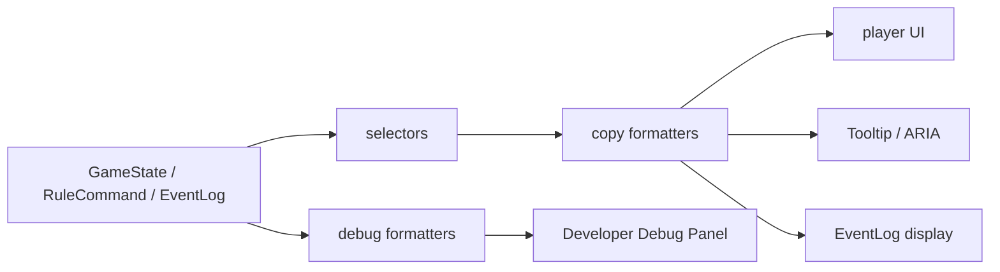

# 29 UI 中文文案与术语系统规格

本文不是一个简单术语表，而是第一版文明类 Web 原型的“玩家可见文案系统”规格。它要解决的问题是：规则层、存档、回放和调试必须继续使用稳定内部 ID；玩家界面、教学目标、错误提示、Tooltip、EventLog 和可访问性文本必须统一显示中文，并且能被测试覆盖。

本轮仍只完善文档，不直接修改 `civlike-web/src/app/App.tsx`。这样可以避免和主线 UI 收纳、试玩面板、地图高亮、调试信息折叠等正在推进的 UI 工作冲突。

## 一、系统定位

### 1.1 为什么不能只做术语替换

当前原型已经有单位、科技、地形、目标提示、攻击状态、建城错误、生产按钮、存档状态、EventLog、调试面板和 smoke 断言。它们不是同一种文案：

| 文案类型 | 例子 | 风险 |
| --- | --- | --- |
| 实体名称 | `unit:scout` 显示为“侦察兵” | 如果散落在 JSX，后续新增单位会漏改。 |
| 动作按钮 | “生产侦察兵”“选择采矿”“建立城市” | 同一个动作在按钮、目标、日志中容易叫法不一致。 |
| 状态摘要 | “当前研究：采矿”“已选单位：侦察兵” | 如果直接显示内部 ID，新玩家看不懂。 |
| 目标提示 | “点击主按钮‘选择采矿’。” | 需要和当前 objective 状态、地图高亮、主按钮优先级联动。 |
| 错误提示 | `FOUND_CITY_BLOCKED_TILE` | 玩家要看到原因，开发者要保留错误码。 |
| 事件日志 | “科技完成：采矿” | 既要可读，也要能关联 CommandLog/debug。 |
| Tooltip/ARIA | 地块、按钮、面板的辅助说明 | 需要短文本、长文本和屏幕阅读器文本分层。 |

所以 29 的目标是定义一套可维护的文案系统，而不是在 UI 里做若干字符串替换。

### 1.2 系统目标

| 目标 | 验收标准 |
| --- | --- |
| 中文术语统一 | 玩家可见区域不裸露 `unit:*`、`tech:*`、命令枚举和错误码。 |
| 调试能力不丢 | 开发调试信息仍能显示内部 ID、错误码、tile id、CommandLog、hash。 |
| 文案可测试 | smoke 能断言玩家文案，单测能断言 formatter 和 fallback。 |
| 新内容可扩展 | 新增单位、科技、地形、建筑、资源时，有固定文案补充清单。 |
| UI 与规则解耦 | 中文化不改 `GameState`、`RuleCommand`、SavedGame、replay/hash。 |
| 新手可理解 | 目标提示、错误提示和按钮文案能回答“能做什么、为什么不能做、下一步点哪里”。 |

### 1.3 非目标

| 非目标 | 原因 |
| --- | --- |
| 不做多语言切换 UI | 当前第一版只需要中文试玩体验。 |
| 不把中文写入规则状态 | 会污染存档、回放和调试复现。 |
| 不为了文案重构规则模块 | 规则层保持纯数据和英文稳定 ID。 |
| 不让 EventLog 成为状态源 | EventLog 只负责解释，不参与规则还原。 |
| 不在本轮直接改 `App.tsx` | 先固定规格，下一轮按小闭环落地。 |

## 二、边界与数据流

### 2.1 文案系统边界

| 层 | 可以包含中文吗 | 说明 |
| --- | --- | --- |
| `game/config/*` | 可以有调试 label，但不作为唯一 UI 文案源 | 当前 terrain 已有 label，但未来应由 formatter 统一兜底。 |
| `GameState` | 不建议 | 状态保存稳定 ID、数值和关系。 |
| `RuleCommand` | 不可以 | 命令必须稳定、可 replay。 |
| `ValidationResult.reason` | 可以保留中文原因 | 但 UI 应通过错误码统一格式化，避免 reason 文案漂移。 |
| `EventLog` | 可以存事件类型和参数，少存最终展示句 | 推荐由 UI 根据 event type + payload 格式化。 |
| `React UI` | 可以显示 formatter 结果 | JSX 不应散落硬编码内部 ID 映射。 |
| `Debug Panel` | 可以同时显示中文和内部 ID | 调试优先完整性。 |
| `tests/smoke` | 可以断言中文玩家文案和调试 ID | 两类断言分开。 |

### 2.2 推荐数据流



核心原则：

- `GameState` 保存 `unit:scout`，UI 显示“侦察兵”。
- `RuleCommand` 保存 `tech:mining`，按钮显示“选择采矿”。
- `ValidationResult` 保存 `FOUND_CITY_BLOCKED_TILE`，玩家提示显示“该地块不能建立城市。”，调试区显示 `FOUND_CITY_BLOCKED_TILE: 该地块不能建立城市。`
- 如果 formatter 遇到未知 ID，玩家区显示“未知单位”，调试区显示原始 ID。

## 三、建议目录与模块

下一轮落地时建议先建轻量文案层，不要把逻辑直接塞进 `App.tsx`。

```text
civlike-web/src/ui/copy/
  copyTypes.ts
  zhCN.ts
  entityCopy.ts
  actionCopy.ts
  objectiveCopy.ts
  validationCopy.ts
  eventCopy.ts
  debugCopy.ts
  formatters.ts
```

| 文件 | 职责 |
| --- | --- |
| `copyTypes.ts` | 定义 `CopyKey`、`CopyContext`、`CopyMode`、formatter 参数类型。 |
| `zhCN.ts` | 静态中文文案表，只放常量和模板，不引用 React。 |
| `entityCopy.ts` | 单位、科技、地形、资源、城市、玩家等实体名称。 |
| `actionCopy.ts` | 按钮、菜单、面板命令、快捷动作文本。 |
| `objectiveCopy.ts` | 当前目标、推荐动作、目标完成状态。 |
| `validationCopy.ts` | Validator 错误、UI 前置失败、存档失败。 |
| `eventCopy.ts` | EventLog 展示文本。 |
| `debugCopy.ts` | 调试区文本，允许保留内部 ID。 |
| `formatters.ts` | 对外统一出口，React 组件只调用这里。 |

建议对外 API：

```ts
formatUnitName(typeId: string, mode?: CopyMode): string
formatUnitInstance(unit: GameUnit, mode?: CopyMode): string
formatTechName(techId: string, mode?: CopyMode): string
formatTerrainName(terrainId: string, mode?: CopyMode): string
formatProductionName(productionId: string, mode?: CopyMode): string
formatValidationError(error: ValidationResult, mode?: CopyMode): string
formatObjective(objective: CurrentObjective, context: CopyContext): ObjectiveCopy
formatGameEvent(event: GameEvent, mode?: CopyMode): string
```

`CopyMode` 至少包含：

| 模式 | 用途 | 示例 |
| --- | --- | --- |
| `player` | 普通玩家界面 | “侦察兵” |
| `debug` | 开发调试信息 | `unit:scout (侦察兵)` |
| `test` | 测试辅助，可稳定断言 | `侦察兵` 或显式测试 helper |

## 四、文案 key 规范

### 4.1 key 命名

文案 key 应稳定、可搜索、可分组。

| 类型 | key 示例 | 文案 |
| --- | --- | --- |
| 单位名 | `entity.unit.scout.name` | 侦察兵 |
| 科技名 | `entity.tech.mining.name` | 采矿 |
| 地形名 | `entity.terrain.grassland.name` | 草地 |
| 资源名 | `entity.yield.food.name` | 食物 |
| 按钮 | `action.production.scout` | 生产侦察兵 |
| 面板字段 | `field.currentTech` | 当前研究 |
| 错误 | `error.FOUND_CITY_BLOCKED_TILE.player` | 该地块不能建立城市。 |
| 目标标题 | `objective.default.moveScout.title` | 移动侦察兵 |
| 目标提示 | `objective.default.moveScout.hint` | 点击侦察兵所在地块，再点击高亮目标地块。 |
| 事件 | `event.tech.completed` | 科技完成：{techName} |
| ARIA | `aria.panel.currentObjective` | 当前目标 |

### 4.2 模板变量

模板变量统一使用业务语义，不使用 UI 层临时名。

| 变量 | 含义 | 示例 |
| --- | --- | --- |
| `{unitName}` | 单位类型中文名 | 侦察兵 |
| `{unitLabel}` | 单位实例可读名 | 侦察兵 1 |
| `{techName}` | 科技中文名 | 采矿 |
| `{terrainName}` | 地形中文名 | 草地 |
| `{tileId}` | 调试坐标或复现坐标 | `tile:8:10` |
| `{cityName}` | 城市名 | 首都 |
| `{current}` | 当前数值 | 10 |
| `{target}` | 目标数值 | 20 |
| `{turn}` | 回合数 | 5 |

规范：

- 玩家文案可出现 `tile:8:10`，但只能用于当前原型缺少更自然地图标记的操作提示。
- 面向玩家的模板不出现 `{unitId}`、`{techId}`、`{commandType}`。
- 调试模板可以显示所有内部字段。

## 五、核心术语表

### 5.1 单位

| 内部 ID | 玩家可见名称 | 单位定位 | 按钮文案 | 状态/日志推荐文案 |
| --- | --- | --- | --- | --- |
| `unit:scout` | 侦察兵 | 探索、揭开迷雾 | 生产侦察兵 | 侦察兵已移动、侦察兵完成生产 |
| `unit:settler` | 开拓者 | 扩张、建立城市 | 生产开拓者、建立城市 | 开拓者已就位、开拓者建立城市 |
| `unit:warrior` | 战士 | 近战、防守、攻击 | 生产战士、攻击 | 战士可以攻击、战士击败目标 |

规则：

- 面向玩家的单位名称只显示“侦察兵 / 开拓者 / 战士”。
- 普通 UI 不写“侦察单位”“settler”“warrior”等混合称呼。
- 调试字段可以显示 `unit:scout:1 @ tile:8:10`。
- 玩家状态摘要推荐显示“已选单位：侦察兵”，必要时补“位置：tile:8:10”。
- 生产按钮统一为“生产 + 单位名”。

### 5.2 科技

| 内部 ID | 玩家可见名称 | 类型 | 按钮文案 | 状态/日志推荐文案 |
| --- | --- | --- | --- | --- |
| `tech:mining` | 采矿 | 基础生产科技 | 选择采矿 | 当前研究：采矿、科技完成：采矿 |

规则：

- 玩家界面不显示 `tech:mining`。
- “选择采矿”只用于主动按钮；状态字段使用“当前研究：采矿”；事件使用“科技完成：采矿”。
- 后续新增科技时必须补齐：名称、简短说明、解锁内容、按钮文案、完成事件。

### 5.3 地形

| 内部 ID | 玩家可见名称 | 地块面板名称 | 产出显示建议 | 移动说明 |
| --- | --- | --- | --- | --- |
| `grassland` | 草地 | 地形：草地 | 食物 2 / 生产 0 / 科研 0 | 移动消耗 1 |
| `forest` | 森林 | 地形：森林 | 食物 1 / 生产 1 / 科研 0 | 移动消耗 2 |
| `hill` | 丘陵 | 地形：丘陵 | 食物 0 / 生产 2 / 科研 0 | 移动消耗 2 |
| `water` | 水域 | 地形：水域 | 食物 1 / 生产 0 / 科研 1 | 移动消耗 2；第一版不可建城 |

规则：

- UI label 统一叫“地形”，不要混用 terrain、地貌、地块类型。
- 地块面板推荐格式：`地形：草地`、`产出：食物 2 / 生产 0 / 科研 0`。
- 内部字段继续使用 `terrainId`、`movementCost`、`food`、`production`、`science`。
- 如果配置 label 出现乱码或缺失，formatter 必须以 ID 映射兜底。

### 5.4 资源与产出

| 内部字段 | 玩家可见名称 | 单位/格式 | 使用场景 |
| --- | --- | --- | --- |
| `food` | 食物 | `食物 {value}` | 地块产出、城市成长 |
| `production` | 生产 | `生产 {value}` | 地块产出、城市生产 |
| `science` | 科研 | `科研 {value}` | 地块产出、科技进度 |
| `gold` | 金币 | `金币 {value}` | 第二阶段经济预留 |
| `culture` | 文化 | `文化 {value}` | 第二阶段边界/政策预留 |
| `faith` | 信仰 | 暂不展示 | 第一版不做宗教系统 |

规则：

- 第一版不要把“生产”混写成“产能”“锤子”“工业值”。
- “科研”用于产出字段，“科技”用于系统和成果，例如“科技完成：采矿”。
- 数字格式保持紧凑，地块面板不需要完整句子。

### 5.5 命令与动作

| 命令/动作 | 玩家按钮 | 玩家状态/提示 | 调试显示 |
| --- | --- | --- | --- |
| `MOVE_UNIT` | 地图点击触发，不单独叫命令 | 移动侦察兵、目标地块必须相邻 | `MOVE_UNIT` |
| `CHOOSE_TECH` | 选择采矿 | 当前研究：采矿 | `CHOOSE_TECH tech:mining` |
| `SET_PRODUCTION` | 生产侦察兵 / 生产开拓者 / 生产战士 | 首都生产：侦察兵 | `SET_PRODUCTION unit:scout` |
| `END_TURN` | 结束回合 | 第 N 回合 | `END_TURN` |
| `FOUND_CITY` | 建立城市 | 开拓者建立城市 | `FOUND_CITY` |
| `ATTACK` | 攻击 | 战士攻击敌方单位 | `ATTACK attacker -> target` |
| Save | 保存游戏 | 已保存 / 保存失败 | storage debug |
| Load | 读取游戏 | 已读取 / 读取失败 | storage debug |

规则：

- 按钮文案使用动词开头。
- 玩家提示中不出现 `CHOOSE_TECH`、`SET_PRODUCTION`。
- Debug Panel 可以保留命令名，并建议同时显示中文摘要。

## 六、玩家 UI 文案分层

### 6.1 主面板

主面板回答“现在做什么”。文案必须短、明确、可点击。

| 区域 | 文案风格 | 示例 |
| --- | --- | --- |
| 当前目标 | 动宾结构 | 移动侦察兵、选择采矿、生产侦察兵 |
| 推荐动作 | 一句话说明点击位置或按钮 | 点击主按钮“选择采矿”。 |
| 试玩状态摘要 | 名词字段 + 短值 | 当前研究：采矿、首都生产：侦察兵 |
| 主要动作按钮 | 动词开头 | 结束回合、保存游戏、攻击 |
| 次级动作按钮 | 仍保持可读 | 读取游戏、生产战士 |

### 6.2 地块/单位/城市详情

详情面板回答“这个对象是什么、能做什么、为什么重要”。

| 对象 | 必备字段 | 文案示例 |
| --- | --- | --- |
| 地块 | 地形、产出、移动消耗、单位、城市 | 地形：森林；产出：食物 1 / 生产 1 / 科研 0 |
| 单位 | 名称、生命值、攻击、位置、可行动作 | 战士；生命值：20 / 20；位置：tile:8:9 |
| 城市 | 名称、产出、当前生产、可生产项 | 首都；当前生产：侦察兵 |
| 科技 | 名称、进度、完成状态 | 当前研究：采矿；已完成科技：采矿 |

规范：

- 字段名固定，减少玩家扫描成本。
- 玩家区可保留 tile id 作为复现坐标，但不要把 tile id 当作对象名称。
- 如果一个字段值未知，显示“无”或“未选择”，不要显示空字符串。

### 6.3 Tooltip

Tooltip 回答“这是什么意思”。它不是百科，不写长段说明。

| Tooltip 类型 | 建议内容 | 长度 |
| --- | --- | --- |
| 按钮 Tooltip | 动作结果、失败条件 | 1-3 行 |
| 地形 Tooltip | 地形名称、产出、移动消耗 | 2-4 行 |
| 单位 Tooltip | 单位职责、生命值、攻击力 | 2-4 行 |
| 科技 Tooltip | 科技效果、预计完成 | 2-5 行 |
| 错误 Tooltip | 原因、下一步建议 | 1-3 行 |

示例：

| 场景 | Tooltip 文案 |
| --- | --- |
| 生产侦察兵 | 让城市开始生产侦察兵。侦察兵适合探索地图。 |
| 选择采矿 | 开始研究采矿。完成后进入已完成科技列表。 |
| 建立城市不可用 | 需要先选择开拓者，并移动到可建城地块。 |
| 攻击不可用 | 需要选择己方战士，并选择可见相邻敌方单位。 |

### 6.4 可访问性文本

ARIA 文案不一定等同视觉文案。它要解释控件身份和当前状态。

| 元素 | ARIA 建议 |
| --- | --- |
| 当前目标面板 | `当前目标` |
| 推荐动作 | `推荐动作` |
| 地图画布 | `六边形地图` |
| 结束回合按钮 | `结束当前回合` |
| 攻击按钮 | `攻击选中的敌方单位` |
| 开发调试折叠区 | `开发调试信息` |

规则：

- ARIA 不写内部 ID，除非该控件位于开发调试区。
- 按钮视觉文案很短时，ARIA 可以补充动作对象。
- smoke 中可以继续通过 role/name 查找中文按钮。

## 七、错误提示系统

### 7.1 错误分层

| 层级 | 来源 | 玩家展示 | 调试展示 |
| --- | --- | --- | --- |
| UI 前置错误 | UI 派生状态 | 操作建议 | 可带命令名 |
| Validator 错误 | `validateRuleCommand` | 中文原因句 | 错误码 + 原因 + command payload |
| Storage 错误 | IndexedDB/localStorage | 保存失败/读取失败 + 简短原因 | exception、slot、schemaVersion |
| Replay 错误 | replay/hash 校验 | 读取的进度无法复现 | command index、expected/actual hash |
| Render 错误 | Pixi/asset | 地图显示异常 | texture id、canvas stats |

### 7.2 展示原则

| 类型 | 面向玩家写法 | 调试写法 |
| --- | --- | --- |
| 命令错误标题 | 命令提示 | 命令错误 |
| 无错误 | 无 | 无 |
| 规则拒绝 | 中文原因句 | `ERROR_CODE: 中文原因句` |
| UI 前置限制 | 中文操作建议 | `COMMAND: 中文原因句` |
| 存档失败 | 保存失败，请稍后重试。 | `SAVE_FAILED: {message}` |

规则：

- 玩家主面板不直接展示 `MOVE_UNIT`、`FOUND_CITY_BLOCKED_TILE`、`SET_PRODUCTION`。
- 玩家错误要回答两件事：为什么不能做、下一步怎么办。
- 调试区保留错误码和 payload，便于 smoke 与 Debug Export 复现。

### 7.3 当前错误文案建议

| 内部码/场景 | 玩家可见文案 | 下一步建议 | 调试文案 |
| --- | --- | --- | --- |
| `NOT_ACTIVE_PLAYER` | 现在不是你的行动阶段。 | 等待当前行动结算完成。 | `NOT_ACTIVE_PLAYER: 不是当前玩家的行动阶段。` |
| `UNIT_NOT_FOUND` | 找不到这个单位。 | 重新选择地图上的己方单位。 | `UNIT_NOT_FOUND: 单位不存在或不属于当前玩家。` |
| `TILE_NOT_FOUND` | 找不到目标地块。 | 重新点击地图上的可见地块。 | `TILE_NOT_FOUND: 目标地块不存在。` |
| `INVALID_MOVE_RANGE` | 目标地块必须与已选单位相邻。 | 选择相邻的高亮地块。 | `INVALID_MOVE_RANGE: 目标地块必须与单位相邻。` |
| `FOUND_CITY_UNIT_REQUIRED` | 需要先选择开拓者。 | 选择开拓者后再建立城市。 | `FOUND_CITY_UNIT_REQUIRED: 只有开拓者可以建立城市。` |
| `FOUND_CITY_TILE_MISMATCH` | 开拓者必须在当前所在地块建城。 | 先把开拓者移动到目标地块。 | `FOUND_CITY_TILE_MISMATCH: 开拓者必须在当前所在地块建城。` |
| `FOUND_CITY_BLOCKED_TILE` | 该地块不能建立城市。 | 选择非水域且没有城市的地块。 | `FOUND_CITY_BLOCKED_TILE: 该地块不能建立城市。` |
| `FOUND_CITY_TOO_CLOSE` | 新城市距离已有城市太近。 | 让开拓者离已有城市更远。 | `FOUND_CITY_TOO_CLOSE: 新城市距离已有城市太近。` |
| `CITY_LIMIT_REACHED` | 城市数量已达到当前版本上限。 | 当前版本最多保留 3 座己方城市。 | `CITY_LIMIT_REACHED: 城市数量已达到当前版本上限。` |
| `CITY_NOT_FOUND` | 需要先选择自己的城市。 | 点击己方城市后再选择生产。 | `CITY_NOT_FOUND: 城市不存在或不属于当前玩家。` |
| `EMPTY_PRODUCTION_ID` | 需要选择一个生产项目。 | 选择侦察兵、开拓者或战士。 | `EMPTY_PRODUCTION_ID: 生产项目 ID 不能为空。` |
| `UNKNOWN_PRODUCTION_ID` | 这个生产项目不存在。 | 重新选择可用生产项目。 | `UNKNOWN_PRODUCTION_ID: 生产项目不存在。` |
| `EMPTY_TECH_ID` | 需要选择一项科技。 | 选择采矿。 | `EMPTY_TECH_ID: 科技 ID 不能为空。` |
| `ATTACKER_NOT_FOUND` | 需要先选择己方战士。 | 点击己方战士所在地块。 | `ATTACKER_NOT_FOUND: 攻击单位不存在或不属于当前玩家。` |
| `ATTACK_INVALID_TARGET` | 不能攻击这个目标。 | 选择可见相邻的敌方单位。 | `ATTACK_INVALID_TARGET: 非法攻击目标。` |
| `ATTACK_TARGET_NOT_VISIBLE` | 目标不可见。 | 移动单位扩大视野后再攻击。 | `ATTACK_TARGET_NOT_VISIBLE: 攻击目标必须在当前可见范围内。` |
| `ATTACK_OUT_OF_RANGE` | 目标必须与战士相邻。 | 移动战士靠近目标。 | `ATTACK_OUT_OF_RANGE: 攻击目标必须与战士相邻。` |
| `TARGET_NOT_FOUND` | 找不到攻击目标。 | 重新选择可见敌方单位。 | `TARGET_NOT_FOUND: 攻击目标不存在。` |

## 八、目标提示系统

目标提示用于“当前目标”“推荐动作”“探索目标状态”等玩家流程引导。它必须和实际 UI 状态一致，不能只是一段静态教程。

### 8.1 目标对象结构建议

```ts
type CurrentObjective = {
  id: string
  titleKey: string
  hintKey: string
  status: 'active' | 'done' | 'locked'
  primaryActionId?: string
  targetTileId?: string
  targetUnitId?: string
  relatedCommand?: RuleCommand['type']
}
```

### 8.2 default 主线目标

| 阶段 | 当前目标 | 推荐动作/说明 | 完成条件 |
| --- | --- | --- | --- |
| `default.moveScout` | 移动侦察兵 | 点击侦察兵所在地块，再点击高亮目标地块。 | `unit:scout:1` 离开初始地块。 |
| `default.chooseMining` | 选择采矿 | 点击主按钮“选择采矿”。 | 当前科技为采矿或采矿已完成。 |
| `default.produceScout` | 生产侦察兵 | 点击主按钮“生产侦察兵”，让首都开始生产。 | 首都生产项目为侦察兵或单位数量增加。 |
| `default.endTurn` | 结束回合 | 点击主按钮“结束回合”。 | 回合数增加。 |
| `default.saveProgress` | 保存进度 | 点击主按钮“保存游戏”。 | 保存状态成功。 |
| `default.exploreProgress` | 完成探索目标 | 继续移动侦察兵，探索更多地块。 | 探索数量达到目标值。 |

### 8.3 combat 支线目标

| 阶段 | 当前目标 | 推荐动作/说明 | 完成条件 |
| --- | --- | --- | --- |
| `combat.selectWarrior` | 选择战士 | 点击己方战士所在地块。 | 已选中己方战士。 |
| `combat.selectEnemy` | 选择敌方单位 | 点击可见且相邻的敌方单位地块。 | 已选中合法攻击目标。 |
| `combat.attackEnemy` | 攻击敌方单位 | 点击主按钮“攻击”。 | 攻击命令成功。 |
| `combat.defeatEnemy` | 击败敌方单位 | 继续攻击直到目标被击败。 | 敌方单位被移除或 HP 降为 0。 |
| `combat.saveResult` | 保存战斗结果 | 点击主按钮“保存游戏”。 | 保存状态成功。 |

### 8.4 建城目标

| 阶段 | 当前目标 | 推荐动作/说明 | 完成条件 |
| --- | --- | --- | --- |
| `city.produceSettler` | 生产开拓者 | 选择城市并点击“生产开拓者”。 | 城市生产项目为开拓者或开拓者完成生产。 |
| `city.moveSettler` | 移动开拓者 | 将开拓者移动到可建城地块。 | 开拓者位于可建城地块。 |
| `city.foundCity` | 建立城市 | 点击主按钮“建立城市”。 | `FOUND_CITY` 成功，城市数量增加。 |
| `city.setNewProduction` | 设置新城生产 | 选择新城市的生产项目。 | 新城市生产项目不为空。 |

规则：

- 目标名称使用动宾结构。
- 推荐动作要和主按钮、高亮地块、当前 selection 一致。
- 不要在目标标题里显示 `unit:*`、`tech:*`。
- 坐标提示只作为当前原型复现辅助，后续地图标记成熟后可弱化。

## 九、EventLog 文案系统

EventLog 既给玩家解释结果，也给开发者定位问题。推荐事件保留结构化 payload，由 `eventCopy.ts` 转成展示文本。

| 事件类型 | 玩家文案模板 | 调试补充 |
| --- | --- | --- |
| `UNIT_MOVED` | {unitName}移动到 {tileId}。 | unitId、fromTileId、toTileId |
| `TILE_EXPLORED` | 新发现 {count} 个地块。 | tileIds |
| `TECH_CHOSEN` | 开始研究：{techName}。 | techId |
| `TECH_COMPLETED` | 科技完成：{techName}。 | techId、turn |
| `PRODUCTION_SET` | {cityName}开始生产：{unitName}。 | cityId、productionId |
| `PRODUCTION_COMPLETED` | 生产完成：{unitName}。 | unitId、cityId |
| `CITY_FOUNDED` | 开拓者建立了新城市。 | unitId、cityId、tileId |
| `ATTACK_RESOLVED` | {attackerName}攻击{targetName}，生命值 {beforeHp} -> {afterHp}。 | attackerId、targetId、damage |
| `UNIT_DEFEATED` | {targetName}被击败。 | targetId |
| `SAVE_COMPLETED` | 游戏已保存。 | slot、updatedAt |
| `LOAD_COMPLETED` | 游戏已读取。 | slot、stateHash |
| `VALIDATION_FAILED` | 操作未完成：{reason} | code、command |

规则：

- 玩家日志默认显示中文摘要。
- Debug Export 继续带完整 payload。
- 不要只记录“成功/失败”，必须包含对象和结果。

## 十、面板与字段命名

### 10.1 面板名称

| UI 区域 | 统一名称 | 不建议 |
| --- | --- | --- |
| 当前流程 | 当前目标 | objective、任务面板、引导 |
| 推荐下一步 | 推荐动作 | hint、提示语、操作建议混用 |
| 玩家状态摘要 | 试玩状态 | debug summary |
| 长调试信息 | 开发调试信息 | 调试摘要、开发信息混用 |
| 地块详情 | 地块详情 | tile info |
| 战斗状态 | 攻击状态 | combat status、攻击提示混用 |
| 探索进度 | 探索目标状态 | exploration target status |

### 10.2 字段名称

| 字段 | 统一中文 | 示例 |
| --- | --- | --- |
| `turn` | 当前回合 | 当前回合：5 |
| `units.length` | 单位数量 | 单位数量：2 |
| `cities.length` | 城市数量 | 城市数量：1 |
| `commandLog.length` | 命令数量 | 命令数量：8 |
| `selectedUnit` | 已选单位 | 已选单位：侦察兵 |
| `selectedTile` | 已选地块 | 已选地块：tile:8:10 |
| `currentTech` | 当前研究 | 当前研究：采矿 |
| `completedTechs` | 已完成科技 | 已完成科技：采矿 |
| `capitalProduction` | 首都生产 | 首都生产：侦察兵 |
| `attackStatus` | 攻击状态 | 攻击状态：需要选择己方战士 |
| `commandError` | 命令提示 | 命令提示：无 |

规则：

- 玩家主面板字段尽量使用 4-6 个字。
- 调试区字段可以更具体，例如“状态 hash”“CommandLog 数量”。
- “命令错误”偏开发语义，玩家区建议改为“命令提示”或“操作提示”。

## 十一、按钮与交互文案

| 场景 | 主按钮 | 次级按钮 | 禁用/不可用提示 |
| --- | --- | --- | --- |
| 科技未选择 | 选择采矿 | 无 | 已选择科技时隐藏或降级。 |
| 城市无生产 | 生产侦察兵 | 生产开拓者、生产战士 | 需要先选择自己的城市。 |
| 可建城 | 建立城市 | 保存游戏 | 需要先选择开拓者。 |
| 可攻击 | 攻击 | 保存游戏、结束回合 | 需要选择可见相邻敌方单位。 |
| 回合结束 | 结束回合 | 保存游戏 | 还有可处理事项时给确认提示。 |
| 存档 | 保存游戏 | 读取游戏 | 保存失败时显示原因。 |

按钮规范：

- 主按钮文案不要超过 6 个汉字，必要时在 Tooltip 解释。
- 不使用“点击这里”“确认操作”这种泛化文案。
- 对同一动作不创建两个同名按钮，避免 role/name smoke 断言混乱。
- `combat` 支线和 `default` 主线可以共用“攻击”“保存游戏”等动作文案，但目标提示必须按场景区分。

## 十二、Fallback 与质量策略

### 12.1 Fallback 规则

| 场景 | 玩家模式 | 调试模式 |
| --- | --- | --- |
| 未知单位 ID | 未知单位 | `unknown unit: {id}` |
| 未知科技 ID | 未知科技 | `unknown tech: {id}` |
| 未知地形 ID | 未知地形 | `unknown terrain: {id}` |
| 未知错误码 | 操作未完成。 | `{code}: {reason}` |
| 缺少模板变量 | 显示保守短句 | 显示 key 和缺失变量 |

### 12.2 禁止行为

| 禁止项 | 原因 |
| --- | --- |
| 在玩家 UI 直接拼 `unit:${name}` | 会泄露内部 ID。 |
| 在 JSX 到处写 `typeId === 'unit:scout' ? '侦察兵' : ...` | 难维护，新增单位容易漏。 |
| 用同一个字段同时服务玩家 UI 和调试 UI | 两者信息密度不同。 |
| 把中文名称写回 `GameState` | 污染存档和 replay。 |
| 只测视觉文案、不测 fallback | 新 ID 会静默显示错误。 |

## 十三、测试与验收

### 13.1 单元测试

| 测试对象 | 用例 |
| --- | --- |
| `formatUnitName` | `unit:scout` -> “侦察兵”；未知 ID -> “未知单位”。 |
| `formatTechName` | `tech:mining` -> “采矿”；未知 ID -> “未知科技”。 |
| `formatTerrainName` | `grassland` -> “草地”；配置 label 乱码时仍正确。 |
| `formatProductionName` | `unit:warrior` -> “战士”。 |
| `formatValidationError` | player/debug 两种模式输出不同文本。 |
| `formatObjective` | default/combat/city 三类目标标题和提示正确。 |
| `formatGameEvent` | 科技完成、生产完成、攻击、建城事件可读。 |

### 13.2 Smoke 测试

| Smoke | 玩家文案断言 | 调试断言 |
| --- | --- | --- |
| `smoke:playable` | “移动侦察兵”“选择采矿”“生产侦察兵”“保存进度” | 调试区仍可看到 `unit:scout`、`tech:mining`。 |
| `smoke:combat` | “选择战士”“选择敌方单位”“攻击敌方单位” | 调试区仍可看到 combat scenario 和 unit ids。 |
| `smoke:30turn` | “探索目标完成 20 / 20” | CommandLog/hash 不变。 |
| 存档读档 smoke | “游戏已保存”“游戏已读取” | state hash 和 command count 可断言。 |

### 13.3 人工验收

| 场景 | 验收问题 |
| --- | --- |
| 新玩家首屏 | 是否能看懂下一步要点哪里。 |
| 非法移动 | 是否知道必须选择相邻地块。 |
| 非法建城 | 是否知道地块不可建城或距离太近。 |
| 攻击不可用 | 是否知道需要选择战士和可见相邻敌人。 |
| 调试折叠区 | 开发者是否仍能拿到内部 ID、错误码和 hash。 |

## 十四、分阶段落地计划

### M29.1 文案层骨架

| 任务 | 范围 | 验收 |
| --- | --- | --- |
| 新增 `src/ui/copy` | 只放 formatter 和 zhCN 文案表 | typecheck 通过。 |
| 单位/科技/地形 formatter | `unit:*`、`tech:*`、terrain | 单测覆盖已知和未知 ID。 |
| 不接 UI | 不改 `App.tsx` 或只接最小测试入口 | 不影响 smoke。 |

### M29.2 玩家主面板中文化

| 任务 | 范围 | 验收 |
| --- | --- | --- |
| 替换主面板状态摘要 | 已选单位、当前研究、首都生产 | 玩家区不裸露 `unit:*`、`tech:*`。 |
| 替换目标提示 | default 主线 | `smoke:playable` 更新并通过。 |
| 保留调试区内部 ID | 开发调试信息 | 调试断言继续通过。 |

### M29.3 错误与攻击状态

| 任务 | 范围 | 验收 |
| --- | --- | --- |
| `formatValidationError` | Validator 错误码 | player/debug 输出分离。 |
| 攻击状态文案 | 需要选择战士、目标不可见、可以攻击 | `smoke:combat` 通过。 |
| 建城错误文案 | blocked/too close/unit required | playable smoke 覆盖。 |

### M29.4 EventLog 与 Tooltip

| 任务 | 范围 | 验收 |
| --- | --- | --- |
| EventLog formatter | 科技、生产、建城、攻击 | 日志不裸露实体内部 ID。 |
| 地块 Tooltip | 地形、产出、移动消耗 | 地块详情可读。 |
| 按钮 Tooltip | 生产/科技/攻击/建城 | 不改变规则行为。 |

### M29.5 文案质量门

| 任务 | 范围 | 验收 |
| --- | --- | --- |
| 增加文案扫描 | 玩家 UI 禁止裸露内部 ID | CI 或本地脚本报告。 |
| 一键验证 | typecheck/test/lint/smoke | `verify:phase2` 通过。 |
| 文档回填 | 29 和 26 状态同步 | 记录已落地范围和剩余债务。 |

## 十五、新增内容清单

新增任何玩法实体时必须补齐文案，而不是先让 UI 显示内部 ID。

### 15.1 新增单位清单

| 项 | 是否必须 |
| --- | --- |
| 内部 ID | 必须 |
| 中文名称 | 必须 |
| 单位定位短句 | 必须 |
| 生产按钮文案 | 必须 |
| 单位 Tooltip | 建议 |
| 生产完成事件 | 必须 |
| 选择/移动/攻击相关错误文案 | 视单位能力 |
| smoke 是否需要覆盖 | 视主线程度 |

### 15.2 新增科技清单

| 项 | 是否必须 |
| --- | --- |
| 内部 ID | 必须 |
| 中文名称 | 必须 |
| 选择按钮文案 | 必须 |
| 当前研究状态 | 必须 |
| 完成事件 | 必须 |
| 解锁说明 | 建议 |
| 科技面板 Tooltip | 建议 |

### 15.3 新增地形清单

| 项 | 是否必须 |
| --- | --- |
| 内部 ID | 必须 |
| 中文名称 | 必须 |
| 产出显示 | 必须 |
| 移动消耗说明 | 必须 |
| 建城/移动限制错误文案 | 视规则 |
| 地块 Tooltip | 建议 |

## 十六、当前已固定的核心决策

| 内部 ID | 玩家显示 |
| --- | --- |
| `unit:scout` | 侦察兵 |
| `unit:settler` | 开拓者 |
| `unit:warrior` | 战士 |
| `tech:mining` | 采矿 |
| `grassland` | 草地 |
| `forest` | 森林 |
| `hill` | 丘陵 |
| `water` | 水域 |

当前命名口径：

- `terrain` 在 UI 中统一叫“地形”。
- 错误提示在玩家区统一叫“命令提示”或“操作提示”，调试区可叫“命令错误”。
- `objective` 在 UI 中统一叫“当前目标”。
- `hint` 在 UI 中统一叫“推荐动作”。
- `debug` 在 UI 中统一叫“开发调试信息”。

## 十七、当前 `App.tsx` 接入点盘点

本节把当前 UI 文案散落位置转成后续迁移清单。这里仍是文档盘点，不直接改代码。

### 17.1 命令入口

| 代码位置/函数 | 当前职责 | 文案风险 | 后续处理 |
| --- | --- | --- | --- |
| `runCommand` | 调用 `tryApplyRuleCommand`，处理成功/失败 | 失败时直接拼 `${result.code}: ${result.reason}`，玩家区会暴露错误码。 | 改为 `formatValidationError(result, 'player')`；调试区用 `debug` 模式。 |
| `chooseMining` | 提交 `CHOOSE_TECH tech:mining` | 内部 ID 和按钮文案分散。 | 按钮和日志调用 `formatTechName('tech:mining')`。 |
| `setCapitalProduction` | 生产 `unit:scout` | 生产对象写死，日志可能显示内部 ID。 | 生产名调用 `formatProductionName`。 |
| `setCapitalSettlerProduction` | 生产 `unit:settler` | 同上。 | 同上。 |
| `setCapitalWarriorProduction` | 生产 `unit:warrior` | 同上。 | 同上。 |
| `setSelectedCityProduction` | 选中城市生产 | UI 前置错误直接写 `SET_PRODUCTION`。 | 玩家提示去掉命令名，调试区保留。 |
| `foundCity` | 建城 | UI 前置错误直接写 `FOUND_CITY`。 | 玩家提示显示“需要先选择开拓者。” |
| `attackSelectedTarget` | 攻击 | UI 前置错误直接写 `ATTACK`。 | 玩家提示显示“需要选择战士和可见相邻敌方单位。” |

### 17.2 状态与事件

| 状态/函数 | 当前文案 | 风险 | 后续处理 |
| --- | --- | --- | --- |
| `saveStatus` | `已保存回合 N / 命令 M` | 可以保留，但缺少统一模板。 | `formatSaveStatus({ turn, commandCount })`。 |
| `persistentSaveStatus` | `保存失败：CODE` | 玩家区暴露存储错误码。 | 玩家显示简短失败原因；调试区保留 code。 |
| `discoveryStatus` | `本次新发现 N 个地块...` | 文案可读，但应进入模板。 | `formatDiscoveryStatus`。 |
| `eventLog` | 字符串数组 | 事件生成时已经丢失结构化信息。 | 中期改为结构化事件；短期先用 `formatCommandEvent`。 |
| `getCommandEvents` | 生产、建城、攻击、科技事件 | 生产完成目前可能显示 `unit.id`。 | 事件统一用 entity formatter。 |

### 17.3 目标提示

| 区域 | 当前逻辑 | 风险 | 后续处理 |
| --- | --- | --- | --- |
| default objectives | 直接用中文 label，如“移动侦察兵” | 可读，但目标 ID 和展示文案没有分离。 | 改为 objective id + formatter。 |
| combat objectives | 直接用中文 label，如“选择战士” | 可读，但难扩展。 | 同上。 |
| `getDefaultExplorationHint` | 根据中文 objective 文案判断 | 用展示文本做逻辑条件，后续改文案会破坏逻辑。 | 用 objective id 判断，文案只用于显示。 |
| `getRecommendedAction` | 判断中文 label 和 includes | 同上。 | 用 `primaryActionId` 或 objective id。 |
| `getCombatObjectiveHint` | 直接拼 tile id | 当前可接受，但后续应由模板处理。 | `formatObjectiveHint(objective, context)`。 |

### 17.4 面板与字段

| UI 区域 | 当前文案 | 后续处理 |
| --- | --- | --- |
| 当前目标 | 已中文化 | 保留视觉文案，底层改 objective id。 |
| 推荐动作 | 已中文化 | 改由 objective formatter 输出。 |
| 科技与生产按钮 | 已中文化 | 按钮名来自 action formatter。 |
| 试玩状态摘要 | 有“命令”“攻击状态”等字段 | 字段名纳入 `field.*` key。 |
| 开发调试信息 | 保留内部 ID | 明确使用 debug formatter，不做玩家化。 |
| 地块详情 | 产出已中文化 | 地形名称必须由 `formatTerrainName` 兜底。 |
| EventLog | 字符串直接展示 | 中期改成结构化 event + formatter。 |

## 十八、Formatter 详细设计

### 18.1 类型定义草案

```ts
export type CopyMode = 'player' | 'debug'

export type CopyFallback = {
  id: string
  kind: 'unit' | 'tech' | 'terrain' | 'production' | 'error' | 'event'
  mode: CopyMode
}

export type ObjectiveCopy = {
  title: string
  hint: string
  primaryActionLabel?: string
  ariaLabel?: string
}
```

### 18.2 实体 formatter

| 函数 | 输入 | player 输出 | debug 输出 |
| --- | --- | --- | --- |
| `formatUnitName` | `unit:scout` | 侦察兵 | `unit:scout (侦察兵)` |
| `formatUnitInstance` | unit object | 侦察兵 | `unit:scout:1 @ tile:8:10 (侦察兵)` |
| `formatTechName` | `tech:mining` | 采矿 | `tech:mining (采矿)` |
| `formatTerrainName` | `grassland` | 草地 | `grassland (草地)` |
| `formatProductionName` | `unit:warrior` | 战士 | `unit:warrior (战士)` |

设计要求：

- `formatProductionName` 第一版只接受单位 ID，但类型上不要假设生产永远是单位；后续建筑会进入生产队列。
- `formatUnitInstance` 在玩家模式默认不显示实例 ID；如果需要复现坐标，由调用方单独显示“位置”字段。
- Debug 模式必须保留原始 ID，不能只显示中文。

### 18.3 错误 formatter

建议签名：

```ts
formatValidationError(
  error: { code: string; reason?: string },
  mode: CopyMode,
): string
```

输出规则：

| 输入 | player | debug |
| --- | --- | --- |
| `FOUND_CITY_BLOCKED_TILE` | 该地块不能建立城市。 | `FOUND_CITY_BLOCKED_TILE: 该地块不能建立城市。` |
| `INVALID_MOVE_RANGE` | 目标地块必须与已选单位相邻。 | `INVALID_MOVE_RANGE: 目标地块必须与单位相邻。` |
| 未知 code + reason | 操作未完成。 | `{code}: {reason}` |
| 未知 code 无 reason | 操作未完成。 | `{code}` |

### 18.4 目标 formatter

目标 formatter 不应该靠标题字符串判断流程，而应该靠稳定 objective id。

```ts
formatObjectiveCopy(
  objectiveId: string,
  context: {
    exploredTileCount?: number
    targetTileId?: string
    selectedUnitName?: string
    primaryOwnWarriorTileId?: string
    saved?: boolean
  },
): ObjectiveCopy
```

示例：

| objective id | title | hint |
| --- | --- | --- |
| `default.moveScout` | 移动侦察兵 | 点击侦察兵所在地块，再点击高亮目标地块。 |
| `default.chooseMining` | 选择采矿 | 侦察兵已探索 {exploredTileCount} 个地块。点击主按钮“选择采矿”。 |
| `combat.selectWarrior` | 选择战士 | 点击己方战士所在地块：{primaryOwnWarriorTileId} |
| `city.foundCity` | 建立城市 | 点击主按钮“建立城市”。 |

## 十九、迁移路线详解

### 19.1 第一刀：不接 UI 的文案层

第一刀只新增 `src/ui/copy` 和单测，不改 `App.tsx`，风险最低。

| 文件 | 内容 |
| --- | --- |
| `src/ui/copy/zhCN.ts` | 中文常量表。 |
| `src/ui/copy/formatters.ts` | 对外 formatter。 |
| `src/ui/copy/formatters.test.ts` | 单元测试。 |
| `src/ui/copy/index.ts` | 统一导出。 |

验收：

- `npm run typecheck` 通过。
- `npm run test -- copy` 或同等测试通过。
- 没有 UI 行为变化。

### 19.2 第二刀：玩家主面板

只替换玩家主面板，不动开发调试信息。

| 替换点 | 处理 |
| --- | --- |
| 当前研究 | `formatTechName(currentTech)` |
| 首都生产 | `formatProductionName(capitalCity.productionId)` |
| 已选单位 | `formatUnitInstance(selectedUnit, 'player')` |
| 地形 | `formatTerrainName(selectedTile.terrainId)` |
| 生产按钮 | `formatActionLabel('produce', productionId)` |

验收：

- 玩家主面板不出现 `unit:scout`、`unit:settler`、`unit:warrior`、`tech:mining`。
- 开发调试信息仍可看到内部 ID。
- `smoke:playable` 更新后通过。

### 19.3 第三刀：目标系统

把目标逻辑从中文 label 判断改成 objective id 判断。

| 当前做法 | 目标做法 |
| --- | --- |
| `nextObjective === '选择采矿'` | `nextObjective.id === 'default.chooseMining'` |
| `nextObjective.includes('保存')` | `nextObjective.kind === 'save'` 或 id 枚举 |
| objectives 保存 `{ label, done }` | objectives 保存 `{ id, done, primaryActionId }` |

验收：

- 改中文文案不会影响目标推进逻辑。
- default/combat smoke 通过。

### 19.4 第四刀：错误提示

把玩家提示和调试提示分开。

| 区域 | 输出 |
| --- | --- |
| 玩家主面板“命令提示” | `formatValidationError(error, 'player')` |
| 开发调试信息“命令错误” | `formatValidationError(error, 'debug')` |
| EventLog 错误事件 | 玩家摘要 + 调试 payload |

验收：

- 玩家主面板不出现 `FOUND_CITY_BLOCKED_TILE` 等错误码。
- 调试区和 Debug Export 仍能定位错误码。

### 19.5 第五刀：EventLog 结构化

短期可以继续用字符串事件，但中期应改为结构化事件。

```ts
type UiEvent =
  | { type: 'PRODUCTION_COMPLETED'; unitTypeId: string; unitId: string }
  | { type: 'TECH_COMPLETED'; techId: string }
  | { type: 'CITY_FOUNDED'; cityId: string; tileId: string }
  | { type: 'ATTACK_RESOLVED'; attackerId: string; targetId: string; beforeHp: number; afterHp: number }
```

验收：

- 玩家日志显示“生产完成：侦察兵”，不是 `unit:scout:2`。
- 调试详情仍能展开看到 `unit:scout:2`。

## 二十、测试样例细化

### 20.1 Formatter 单测样例

```ts
describe('copy formatters', () => {
  it('formats known unit ids for players', () => {
    expect(formatUnitName('unit:scout', 'player')).toBe('侦察兵')
    expect(formatUnitName('unit:settler', 'player')).toBe('开拓者')
    expect(formatUnitName('unit:warrior', 'player')).toBe('战士')
  })

  it('keeps ids in debug mode', () => {
    expect(formatUnitName('unit:scout', 'debug')).toBe('unit:scout (侦察兵)')
  })

  it('uses safe fallback for unknown ids', () => {
    expect(formatUnitName('unit:unknown', 'player')).toBe('未知单位')
    expect(formatUnitName('unit:unknown', 'debug')).toBe('unknown unit: unit:unknown')
  })
})
```

### 20.2 Smoke 断言策略

| 区域 | 应断言 | 不应断言 |
| --- | --- | --- |
| 玩家主面板 | “侦察兵”“采矿”“草地” | `unit:scout`、`tech:mining` |
| 开发调试信息 | `unit:scout`、`tech:mining`、错误码 | 纯玩家文案是否存在 |
| 目标面板 | 当前目标中文标题 | 目标判断依赖中文字符串 |
| EventLog | 玩家可读事件 | 内部 payload 完整性，除非展开调试详情 |

### 20.3 文案扫描脚本建议

后续可以新增一个只扫玩家区域测试输出的脚本，而不是全仓库禁用内部 ID。

| 扫描对象 | 规则 |
| --- | --- |
| `App.tsx` 玩家主面板片段 | 不出现直接渲染的 `unit:*` / `tech:*`。 |
| `scripts/run-*-smoke.mjs` 玩家断言 | 优先断言中文。 |
| Debug 断言 | 允许内部 ID。 |
| `game/`、`tests/fixtures` | 允许内部 ID。 |

## 二十一、风险与取舍

| 风险 | 说明 | 控制方式 |
| --- | --- | --- |
| 过早做完整 i18n | 会拖慢第一版试玩闭环。 | 只做中文 formatter，不做语言切换 UI。 |
| 一次性替换整个 `App.tsx` | 容易和主线 UI 收纳冲突。 | 按 M29.1-M29.5 小步落地。 |
| 玩家文案和调试文案混用 | 新玩家看不懂，开发者也难查。 | `CopyMode` 强制区分。 |
| 目标逻辑依赖中文字符串 | 改文案会破坏流程。 | 目标改用稳定 id。 |
| EventLog 只存字符串 | 后续无法重新格式化或做多视图。 | 中期改结构化事件。 |
| formatter 变成规则依赖 | UI 文案层反向污染规则层。 | formatter 只读 ID，不调用 simulation。 |

## 二十二、下一步执行建议

如果继续进入代码实现，建议按这个顺序执行：

1. 新建 `src/ui/copy`，实现单位、科技、地形 formatter。
2. 加 formatter 单测，覆盖 player/debug/fallback。
3. 只把地块详情和主面板的实体显示接入 formatter。
4. 再处理错误提示，把玩家提示和调试错误分开。
5. 最后改目标系统，把中文 label 判断换成 objective id。

暂时不建议先改 EventLog 结构，因为那会碰到事件生成、smoke 断言和 Debug Export 的边界，适合等 M29.1-M29.3 稳定后再做。

## 二十三、文案资源表草案

本节给出 `zhCN.ts` 的内容形态草案。它不是最终代码，但足够指导实现时怎么组织文案，避免所有文案堆在一个大对象里。

### 23.1 实体文案

```ts
export const entityCopy = {
  unit: {
    'unit:scout': {
      name: '侦察兵',
      role: '探索地图，揭开战争迷雾。',
      produceAction: '生产侦察兵',
      completedEvent: '生产完成：侦察兵',
    },
    'unit:settler': {
      name: '开拓者',
      role: '建立新城市，扩大领土。',
      produceAction: '生产开拓者',
      completedEvent: '生产完成：开拓者',
    },
    'unit:warrior': {
      name: '战士',
      role: '近战攻击和防守。',
      produceAction: '生产战士',
      completedEvent: '生产完成：战士',
    },
  },
  tech: {
    'tech:mining': {
      name: '采矿',
      chooseAction: '选择采矿',
      completedEvent: '科技完成：采矿',
      summary: '基础生产科技。',
    },
  },
  terrain: {
    grassland: { name: '草地' },
    forest: { name: '森林' },
    hill: { name: '丘陵' },
    water: { name: '水域' },
  },
}
```

实现要求：

- `entityCopy` 不引用 React、不读 `GameState`。
- `role` 和 `summary` 用于 Tooltip 或百科摘要，不在主按钮里展示。
- 当前只有一个科技，也要按可扩展结构写，避免后续加科技时改 API。

### 23.2 字段与按钮文案

```ts
export const fieldCopy = {
  activePlayer: '当前玩家',
  attackStatus: '攻击状态',
  capitalProduction: '首都生产',
  commandCount: '命令数量',
  commandHint: '命令提示',
  completedTechs: '已完成科技',
  currentObjective: '当前目标',
  currentTech: '当前研究',
  debugInfo: '开发调试信息',
  eventLog: '最近事件',
  recommendation: '推荐动作',
  selectedTile: '已选地块',
  selectedUnit: '已选单位',
  terrain: '地形',
  turn: '当前回合',
}

export const actionCopy = {
  attack: '攻击',
  endTurn: '结束回合',
  foundCity: '建立城市',
  loadGame: '读取游戏',
  persistentLoad: '持久读取',
  persistentSave: '持久保存',
  saveGame: '保存游戏',
}
```

实现要求：

- 字段文案集中管理，避免“命令错误 / 命令提示 / 操作提示”混用。
- `persistentSave` 这类偏调试/开发的按钮可以保留更技术化的叫法，但必须放在开发或存档分组里。
- 如果后续做公开试玩版，可以把“持久保存/持久读取”改成“保存到浏览器/从浏览器读取”。

### 23.3 目标文案

```ts
export const objectiveCopy = {
  'default.moveScout': {
    title: '移动侦察兵',
    hint: '点击侦察兵所在地块，再点击高亮目标地块。',
  },
  'default.chooseMining': {
    title: '选择采矿',
    hint: '侦察兵已探索 {exploredTileCount} 个地块。点击主按钮“选择采矿”。',
  },
  'default.produceScout': {
    title: '生产侦察兵',
    hint: '点击主按钮“生产侦察兵”，让首都开始生产。',
  },
  'default.endTurn': {
    title: '结束回合',
    hint: '点击主按钮“结束回合”，推进生产和科研。',
  },
  'default.saveProgress': {
    title: '保存进度',
    hint: '点击主按钮“保存游戏”，记录当前进度。',
  },
  'combat.selectWarrior': {
    title: '选择战士',
    hint: '点击己方战士所在地块：{tileId}',
  },
  'combat.attackEnemy': {
    title: '攻击敌方单位',
    hint: '点击主按钮“攻击”。',
  },
}
```

实现要求：

- 目标 id 是逻辑判断依据，title/hint 只是展示。
- 模板变量缺失时，玩家区必须显示保守文案，不要把 `{tileId}` 原样显示出来。
- `combat` 和 `default` 不共用目标 id，即使 title 看起来相似。

## 二十四、代码骨架示例

### 24.1 `formatters.ts` 草案

```ts
type CopyMode = 'player' | 'debug'

const unitNames: Record<string, string> = {
  'unit:scout': '侦察兵',
  'unit:settler': '开拓者',
  'unit:warrior': '战士',
}

export function formatUnitName(typeId: string, mode: CopyMode = 'player'): string {
  const name = unitNames[typeId]

  if (!name) {
    return mode === 'debug' ? `unknown unit: ${typeId}` : '未知单位'
  }

  return mode === 'debug' ? `${typeId} (${name})` : name
}
```

实现注意：

- 先做简单对象映射，不需要引入第三方 i18n 库。
- formatter 要小而稳定，先覆盖当前真实 ID。
- 等科技、建筑、AI 文案多起来后，再考虑拆子模块。

### 24.2 React 接入示例

```tsx
<dt>已选单位</dt>
<dd>{selectedUnit ? formatUnitName(selectedUnit.typeId) : '无'}</dd>

<dt>当前研究</dt>
<dd>{currentTech ? formatTechName(currentTech) : '无'}</dd>

<dt>首都生产</dt>
<dd>{capitalCity?.productionId ? formatProductionName(capitalCity.productionId) : '无'}</dd>
```

接入原则：

- 先替换显示值，不改变 selector、command 或 state shape。
- 每次接入 formatter 后跑对应 smoke，确认玩家区和调试区的断言没有混在一起。
- 不要在同一 PR 同时做视觉样式重排和文案系统接入。

### 24.3 错误接入示例

```ts
type CommandErrorState =
  | null
  | {
      code: string
      reason?: string
      source: 'validator' | 'ui' | 'storage'
    }
```

推荐把 `commandError` 从字符串逐步改为结构化对象。短期如果不想动状态结构，也可以先在设置字符串时调用 formatter：

```ts
setCommandError(formatValidationError(result, 'player'))
setDebugCommandError(formatValidationError(result, 'debug'))
```

取舍：

- 结构化错误更正确，但改动面更大。
- 先双写 player/debug 字符串更小，但后续要回收技术债。
- 不建议继续只存一个字符串同时服务玩家区和调试区。

## 二十五、未来系统文案预留

当前可玩原型只落地了少量单位、科技和战斗，但 13、14 已经规划了百科、胜利、外交和 AI 意图。文案系统需要提前定义口径，避免后续新增系统时又回到散写字符串。

### 25.1 建筑

| 内部 ID 建议 | 中文名 | 定位 | Tooltip 摘要 |
| --- | --- | --- | --- |
| `building:granary` | 粮仓 | 成长建筑 | 提高城市成长稳定性。 |
| `building:workshop` | 工坊 | 生产建筑 | 提高城市生产能力。 |
| `building:market` | 市场 | 经济建筑 | 提高金币收入，缓解维护压力。 |
| `building:academy` | 学院 | 科研建筑 | 提高科研产出，推进科技路线。 |
| `building:walls` | 城墙 | 防御建筑 | 提高城市防御能力。 |

命名规则：

- 建筑生产按钮统一为“建造 + 建筑名”，例如“建造工坊”。
- 生产完成事件统一为“建造完成：工坊”。
- 建筑效果不要写成长段，Tooltip 只写最短可理解效果，详细公式进入百科。

### 25.2 扩展科技

| 内部 ID 建议 | 中文名 | 路线 | 文案重点 |
| --- | --- | --- | --- |
| `tech:agriculture` | 农业 | 成长 | 支撑人口和粮食。 |
| `tech:scouting` | 侦察 | 探索 | 提高地图信息获取。 |
| `tech:archery` | 弓术 | 军事 | 解锁远程防御。 |
| `tech:writing` | 书写 | 科研 | 解锁学院和科研路线。 |
| `tech:trade` | 贸易 | 经济 | 支撑金币和维护。 |
| `tech:masonry` | 石工 | 防御 | 支撑城墙和城市防御。 |
| `tech:mathematics` | 数学 | 科技胜利 | 进入科技胜利关键路线。 |
| `tech:observatory` | 天文台计划 | 科技胜利 | 科技胜利项目。 |

命名规则：

- 科技名尽量用名词，不写成“研究采矿术”。
- 按钮使用“选择 + 科技名”。
- 完成事件使用“科技完成：科技名”。
- 胜利项目可以有特殊标签，但仍归入科技/项目 formatter。

### 25.3 AI 意图

| 内部 intent | 玩家文案 | 调试文案 |
| --- | --- | --- |
| `explore` | AI 正在探索未知地图。 | 探索评分、候选地块、单位路径。 |
| `expand` | AI 正在寻找新城市位置。 | 建城点评分、经济余量、候选 tile。 |
| `economy` | AI 正在补充经济。 | 金币、维护、市场评分。 |
| `science` | AI 正在追求科技路线。 | 科技差距、候选科技、胜利压力。 |
| `defend` | AI 认为边境存在军事威胁。 | 威胁单位、距离、军力差。 |
| `attack` | AI 正在准备进攻。 | 宣战评分、目标城市、路径估算。 |
| `recover` | AI 正在恢复实力。 | 损失、金币、城市风险。 |

命名规则：

- 玩家文案只展示合法可见或半公开信息，不泄露未知地图和隐藏单位。
- 调试文案可以展示完整评分表。
- AI 意图事件必须进入 EventLog 或外交面板，不要只放 Debug。

### 25.4 外交状态

| 内部状态 | 玩家显示 | 说明 |
| --- | --- | --- |
| `unknown` | 未接触 | 双方尚未发现对方。 |
| `peace` | 和平 | 可以发展，但仍可能产生边境压力。 |
| `tense` | 紧张 | 边境、军力或科技压力导致关系恶化。 |
| `war` | 战争 | 双方可以攻击单位和城市。 |

事件文案：

| 场景 | 玩家 EventLog |
| --- | --- |
| 关系下降 | 关系下降：你的单位靠近了 AI 首都。 |
| AI 扩张 | AI 的扩张引发边境紧张。 |
| 玩家攻击 | 你发动了攻击，战争爆发。 |
| AI 宣战 | AI 宣战：它认为边境和军力压力已经不可忽视。 |

### 25.5 胜利与复盘

| 胜利类型 | 中文名 | 面板文案重点 |
| --- | --- | --- |
| `victory:conquest` | 征服胜利 | 首都状态、敌军距离、战争进度。 |
| `victory:science` | 科技胜利 | 关键科技、项目进度、预计完成。 |
| `victory:score` | 分数胜利 | 城市、科技、单位、金币和首都伤害得分。 |

复盘文案规则：

- 只陈述规则事实，不评价玩家。
- 使用“你有 4 回合没有研究科技”这类可行动事实。
- 不使用“表现糟糕”“策略错误”等评价性措辞。

## 二十六、百科与 Tooltip 衔接

百科是长说明，Tooltip 是短说明，两者不能混在一起。

| 类型 | 目标 | 示例 |
| --- | --- | --- |
| Tooltip | 当前对象的即时解释 | “森林提供食物 1、生产 1，移动消耗 2。” |
| 百科摘要 | 系统概念的短解释 | “生产用于城市制造单位和建筑。” |
| 百科正文 | 完整规则说明 | “城市每回合把生产累计到当前生产项目，达到成本后完成。” |
| Debug 说明 | 开发者排查信息 | `productionId=unit:scout, accumulated=3/4` |

深链 key 建议：

| 对象 | 百科 key |
| --- | --- |
| 侦察兵 | `pedia.unit.scout` |
| 开拓者 | `pedia.unit.settler` |
| 战士 | `pedia.unit.warrior` |
| 采矿 | `pedia.tech.mining` |
| 草地 | `pedia.terrain.grassland` |
| 建城 | `pedia.rule.foundCity` |
| 攻击 | `pedia.rule.attack` |
| 保存 | `pedia.system.saveLoad` |

规则：

- Tooltip 超过 8 行时必须改成摘要 + 百科链接。
- 百科正文可以包含内部 ID 的调试附录，但默认折叠。
- 玩家首屏不主动弹百科，避免打断操作。

## 二十七、PR 检查清单

任何涉及 UI 文案的 PR，都应该检查以下项目。

| 检查项 | 必须 |
| --- | --- |
| 玩家可见文案是否使用 formatter 或 copy key | 是 |
| 新增内部 ID 是否补中文名称 | 是 |
| Debug 区是否仍保留内部 ID | 是 |
| 错误提示是否区分 player/debug | 是 |
| 目标逻辑是否避免依赖中文字符串 | 是 |
| smoke 断言是否区分玩家区和调试区 | 是 |
| Tooltip 是否过长 | 是 |
| 是否把中文写入 `GameState` 或 `RuleCommand` | 必须没有 |
| 是否影响 replay/hash | 必须没有，除非本 PR 明确改规则 |
| 是否更新 29 或相关文档 | 文案系统变化时必须 |

## 二十八、Definition of Done

### 28.1 M29 文案层 DoD

| 维度 | 完成标准 |
| --- | --- |
| 代码结构 | 存在 `src/ui/copy`，React 从统一出口调用 formatter。 |
| 实体文案 | 当前单位、科技、地形全部有 player/debug 输出。 |
| 错误文案 | Validator 错误能输出玩家文案和调试文案。 |
| 目标文案 | default/combat/city 目标由 id 驱动。 |
| 测试 | formatter 单测覆盖已知、未知、debug。 |
| smoke | 玩家区断言中文，调试区断言内部 ID。 |
| 文档 | 29 更新已落地范围和剩余债务。 |

### 28.2 玩家体验 DoD

| 场景 | 完成标准 |
| --- | --- |
| 新局首屏 | 玩家能看到“移动侦察兵”和明确点击提示。 |
| 选择科技 | 玩家只看到“采矿”，不看到 `tech:mining`。 |
| 设置生产 | 玩家只看到“侦察兵/开拓者/战士”，不看到 `unit:*`。 |
| 地块详情 | 地形名和产出可读，乱码 label 不进入玩家区。 |
| 非法操作 | 玩家看到原因和下一步建议，不看到错误码。 |
| 调试排查 | 开发者能展开看到内部 ID、错误码、hash、CommandLog。 |

## 二十九、开放问题

| 问题 | 当前建议 | 何时决定 |
| --- | --- | --- |
| 是否做完整多语言 | 暂不做，只做中文 copy 层。 | 准备公开国际化试玩前。 |
| EventLog 是否立即结构化 | 暂缓，先完成 formatter 和错误分层。 | M29.4 前。 |
| 是否在 config 中加入中文 label | 可以有，但 UI 仍以 formatter 为准。 | 新增更多配置表时。 |
| 是否把“持久保存”改成玩家友好文案 | 公开试玩前改成“保存到浏览器”。 | 存档 UI 正式化时。 |
| 是否保留 tile id 在玩家提示里 | 当前保留，便于复现；后续地图标记成熟后弱化。 | 地图引导视觉稳定后。 |
| 是否给每个按钮都加 Tooltip | 关键按钮先加，普通重复按钮后加。 | M29.4。 |

## 三十、本轮边界

- 本轮继续完善 29，新增文案资源表草案、代码骨架示例、未来系统文案预留、百科/Tooltip 衔接、PR 检查清单、Definition of Done 和开放问题。
- 本轮没有修改 `App.tsx`。
- 本轮没有改变规则层、存档、回放、hash 或 smoke 行为。
- 下一轮如进入实现，建议从 M29.1 开始，先做 formatter 单测，再接玩家主面板。
